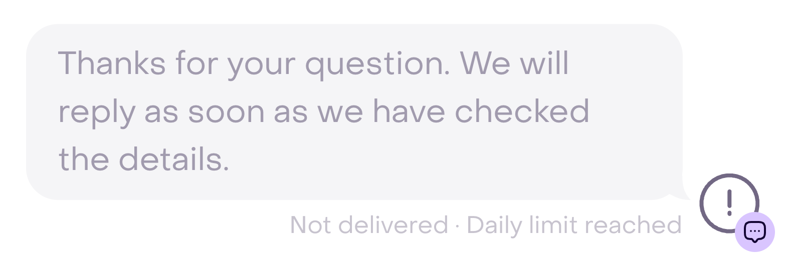
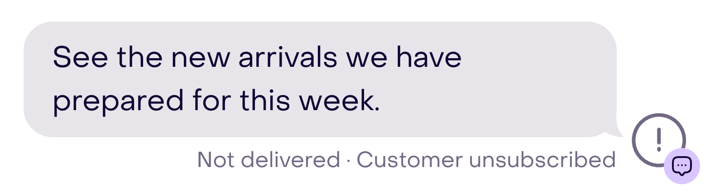
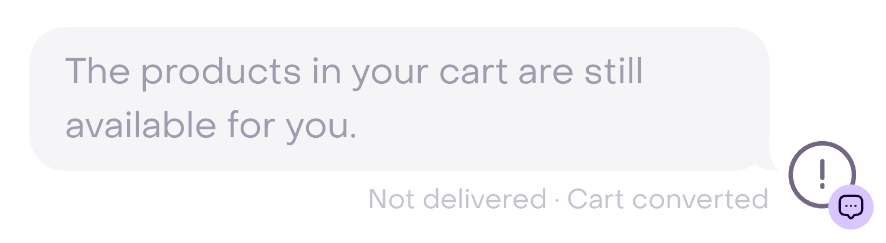
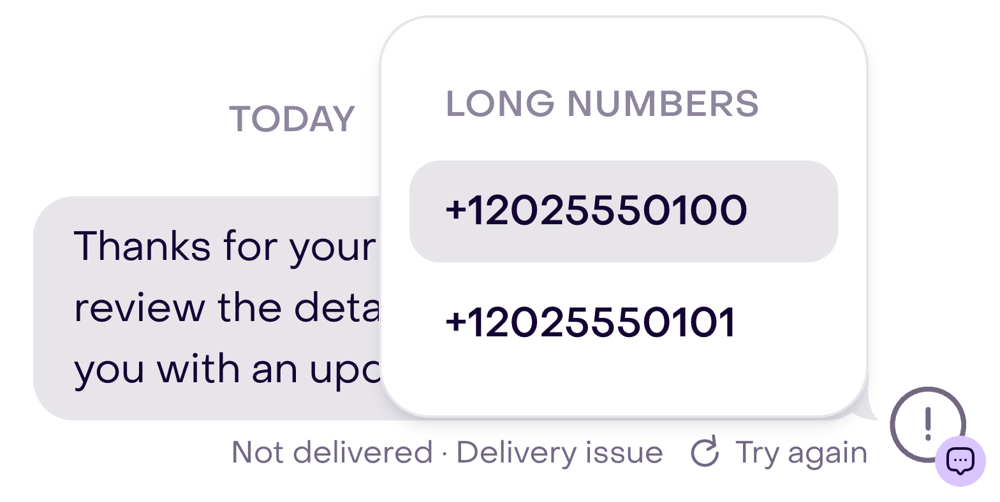

Use this guide when you expected a message from a campaign, playbook, route, conversation, or integration, but it did not send or did not reach the customer.

Start by finding the message or the activity that should have created it. Your next step depends on whether the message never existed, is still processing, or ended with a delivery error.

## First identify what happened

### The message was never created

If you cannot find a message, you are not dealing with a delivery failure yet. Check its source:

- **Campaign:** confirm that it is not still a draft, under review, or scheduled, and that the customer profile was eligible for the selected audience and channels.
- **Playbook:** confirm that it triggered, the opportunity is still valid, and Hellotext decided to send at that time.
- **Route:** review the trigger, conditions, waits, branches, and the step that should send.
- **Inbox:** confirm that the reply was sent and did not remain an internal note or draft.
- **API:** confirm that the request was accepted, then review the actual message state. A `status: received` response confirms receipt of the request, not delivery to the customer.

For automations, see [Troubleshoot a playbook that did not trigger or send](). If the activity that should start the flow is missing, use [Troubleshoot missing signals or activity]().

### The message is pending or routed

A message can exist without a final confirmation yet:

- `pending` means it is waiting for processing;
- `routed` means it was sent to the external provider; and
- `delivered` means the provider confirmed delivery.

Check the message time and allow a reasonable processing period before retrying. A provider delay does not always end in failure, and creating another message too soon can produce a duplicate.

### The message appears as not delivered

Open the message in the conversation and read the reason shown next to **Not delivered**. Hellotext normalizes the channel response to explain what prevented delivery and, when appropriate, can offer **Try again**, a selection of available channels, or an action that corrects the account.

The exact reason is more useful than the general state. Record it before changing settings.

For example, **Not delivered · Daily limit reached** identifies an account limit. The error icon and reason appear beside the message.

<figure class="ht-editorial-visual ht-editorial-visual--screenshot" aria-label="Identify the reason beside the message">
  

    

      <picture>
        <source media="(max-width: 600px)" srcset="/images/editorial/sms-sending-limits/error-en-mobile.png 4x" width="1624" height="528" />
        
      </picture>
    

  

  <figcaption class="ht-editorial-visual__caption">Real interface with fictional data. No message was sent or retried.</figcaption>
</figure>

## Customer data and consent

Do not retry a message when the customer profile is unsubscribed. The opt-out must be respected for every send that depends on that consent.

The **Customer unsubscribed** reason identifies this case in the Inbox. Hellotext does not offer **Try again** for this failure.

<figure class="ht-editorial-visual ht-editorial-visual--screenshot" aria-label="Recognize a message blocked by an unsubscribe">
  

    

      <picture>
        <source media="(max-width: 600px)" srcset="/images/editorial/message-delivery-failure/unsubscribed-en-mobile.png 4x" width="1624" height="432" />
        
      </picture>
    

  

  <figcaption class="ht-editorial-visual__caption">Real interface with fictional data. No message was sent or retried.</figcaption>
</figure>

Also check that the customer profile has a valid identity for the channel:

- a complete and correct phone number for SMS or WhatsApp;
- an account that is reachable through the corresponding channel; and
- a block and subscription state compatible with the message.

If the customer has another available channel, Hellotext may let you choose it for a new attempt. An alternative channel does not bypass its consent rules.

See [Who can you message?]() to distinguish identity, verification, reachability, and subscription.

## Billing and account limits

The message can be blocked when the business needs to:

- add or update a payment method;
- add funds or enable automatic top-up;
- increase a recharge limit; or
- resolve a daily or monthly message limit.

Correct the indicated condition before retrying. If the reason is a temporary daily limit, wait until sending is allowed again. For new SMS accounts, see [SMS sending limits for new businesses]().

## Channel or sender problems

Confirm that the channel is still connected and active, the selected sender belongs to the business, and the integration retains the required permissions.

A setup that worked before can stop working if an account is disconnected, a permission changes, Meta restricts a number, or the provider becomes temporarily unavailable.

Do not change the content or automation until you confirm whether the reason belongs to the channel. See [Messaging channels overview]() to return to the corresponding setup.

## WhatsApp reasons

Common reasons include:

- **24-hour window closed:** a free-form message can no longer be sent. Use an approved template or an available alternative channel.
- **Number unreachable:** Meta could not deliver to the customer's number.
- **Marketing limited or opted out:** Meta limited the marketing message or the customer indicated that they do not want it.
- **Template paused or disabled:** use another approved template or correct its status in Meta.
- **Display name pending:** Meta must approve the name before sending is enabled.
- **Permissions, registration, policies, or payment:** review the account and number in Meta.
- **Sending limit or service temporarily unavailable:** wait before retrying.
- **Active experiment:** Meta may exclude that message from a delivery experiment. If Hellotext offers another eligible channel, you can use it.

Do not immediately repeat a send limited by Meta. Correct the condition or wait for the indicated period first. For content that is still under review or rejected, check the template state before scheduling the campaign again.

## SMS reasons

An SMS can appear as undelivered when:

- the carrier reported that it did not reach the recipient;
- the provider canceled the send;
- the number is invalid or unavailable; or
- the provider had a temporary problem.

Check the international number format and avoid repeatedly sending to destinations that the carrier marked as unreachable. If the problem was temporary and Hellotext shows **Try again**, wait a few minutes and retry once.

## Mercado Libre reasons

Mercado Libre can prevent sending because of:

- the time or limits on seller-initiated conversations;
- the payment or fulfillment state;
- a buyer block;
- an active mediation; or
- guest-shop restrictions.

These reasons depend on the operation or conversation state in Mercado Libre. Correct or wait for that state before retrying; changing the message text does not remove the restriction.

## The message was no longer relevant

Some playbook messages are intentionally canceled before sending because the opportunity changed. For example:

- the customer completed the cart or purchased the product;
- the product is out of stock or no longer available;
- the checkout URL is missing;
- a newer price change replaced the earlier one; or
- the order that originated a reminder was canceled or refunded.

Do not retry the message in these cases. The cancellation prevents outdated information or unnecessary contact after the customer already converted.

For example, **Cart converted** means that the reminder is no longer relevant. No retry action appears.

<figure class="ht-editorial-visual ht-editorial-visual--screenshot" aria-label="Recognize a cancellation after a cart converted">
  

    

      <picture>
        <source media="(max-width: 600px)" srcset="/images/editorial/message-delivery-failure/converted-en-mobile.png 4x" width="1624" height="432" />
        
      </picture>
    

  

  <figcaption class="ht-editorial-visual__caption">Real interface with fictional data. No message was sent or retried.</figcaption>
</figure>

## Decide whether to retry

Retry only when:

- the reason was temporary;
- you corrected the setup, payment, or permissions; and
- Hellotext shows a valid option to retry or choose another channel.

If several options are available, **Try again** opens a menu of eligible channels or senders. Choose one only after resolving the cause. When the only option is the same channel, **Try again** can start the new attempt directly, without opening a menu.

<figure class="ht-editorial-visual ht-editorial-visual--screenshot" aria-label="Choose among the available senders for a retry">
  

    

      <picture>
        <source media="(max-width: 600px)" srcset="/images/editorial/message-delivery-failure/retry-en-mobile.png 4x" width="1624" height="788" />
        
      </picture>
    

  

  <figcaption class="ht-editorial-visual__caption">Real interface with fictional data. No message was sent or retried.</figcaption>
</figure>

Do not retry when:

- the customer is unsubscribed or blocked messages;
- the destination is definitively unreachable;
- the message no longer applies because of a purchase, cancellation, or product change; or
- the platform prohibits that message type in the current conversation.

After retrying, confirm that the new message reaches `delivered`. Do not use repeated retries to work around a cause that is still active.

## What to include when asking for help

If the reason is not enough to resolve the problem, include:

- business name;
- link to the customer profile and conversation;
- source campaign, playbook, route, or integration;
- channel and sender;
- date, time, and time zone;
- exact reason shown under **Not delivered**;
- result of any retry; and
- screenshot and recent setup changes.

Do not include API tokens, passwords, or complete payment details.

## Related guides

- [Review delivery errors in Audience]()
- [Troubleshooting checklist]()
- [Troubleshoot a playbook that did not trigger or send]()
- [How Hellotext decides whether a playbook can send]()
- [Create a campaign]()
- [Send SMS with the API]()
